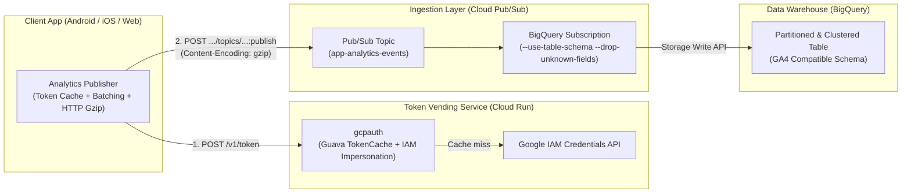

# pubsubauth: Direct Mobile Analytics Ingestion to Cloud Pub/Sub & BigQuery

This repository provides an end-to-end reference implementation for streaming client-side analytics events (aligned with the **Google Analytics 4 / Firebase BigQuery Export Schema**) directly from mobile/client applications to **Google Cloud Pub/Sub** and **BigQuery** without managing intermediate Dataflow or consumer clusters.

## Architecture Overview

### Key Capabilities
1. **Keyless Client Authentication (`gcpauth`)**:
   - Deployed on **Cloud Run** using **Service Account Impersonation (`ImpersonatedCredentials`)**.
   - Issues short-lived, least-privilege OAuth 2.0 access tokens (`https://www.googleapis.com/auth/pubsub`) scoped strictly to publishing messages.
   - Includes in-memory token caching (`TokenCache`) so Cloud Run instances reuse active tokens across requests and avoid IAM API quota bottlenecks.
2. **Efficient Client Publishing (`android-app`)**:
   - **Local Token Caching**: Caches the short-lived OAuth2 token in memory with a 5-minute refresh buffer and automatic retry on `401 Unauthorized`.
   - **HTTP Transport-Layer Gzip Compression**: Uses an `OkHttp` interceptor (`GzipRequestInterceptor`) to compress the HTTP `:publish` request body (`Content-Encoding: gzip`) while keeping `PubsubMessage.data` as Base64-encoded UTF-8 JSON. Google's frontend transparently decompresses the HTTP request so Pub/Sub BigQuery Subscriptions can parse the JSON payload directly into structured columns.
   - **GA4-Compatible Payload Structure**: Formats events with nested `event_params` (`ARRAY<STRUCT<key, value>>`), `device`, and `app_info` records matching the native GA4 BigQuery Export schema.
3. **Zero-ETL BigQuery Ingestion**:
   - Uses a **Cloud Pub/Sub BigQuery Subscription** (`--use-table-schema` and `--drop-unknown-fields`) to stream published JSON events directly into a partitioned and clustered BigQuery table in sub-seconds.

## Project Structure

- **[`gcpauth`](./gcpauth/README.MD)**: Spring Boot (Java 17) token-vending service deployed on Cloud Run.
- **[`android-app`](./android-app/app/README.MD)**: Android client demonstrating token caching, HTTP transport-layer Gzip compression, and GA4 event publishing to Cloud Pub/Sub.

## Quick Start

1. Follow the **[gcpauth deployment guide](./gcpauth/README.MD)** to configure Service Account Impersonation and deploy the token service to Cloud Run.
2. Create a BigQuery table with the GA4-compatible schema and a Pub/Sub topic + BigQuery Subscription (`--use-table-schema --drop-unknown-fields`).
3. Follow the **[Android App guide](./android-app/app/README.MD)** to configure `ConfigConstant.java` and publish analytics events to Cloud Pub/Sub.
