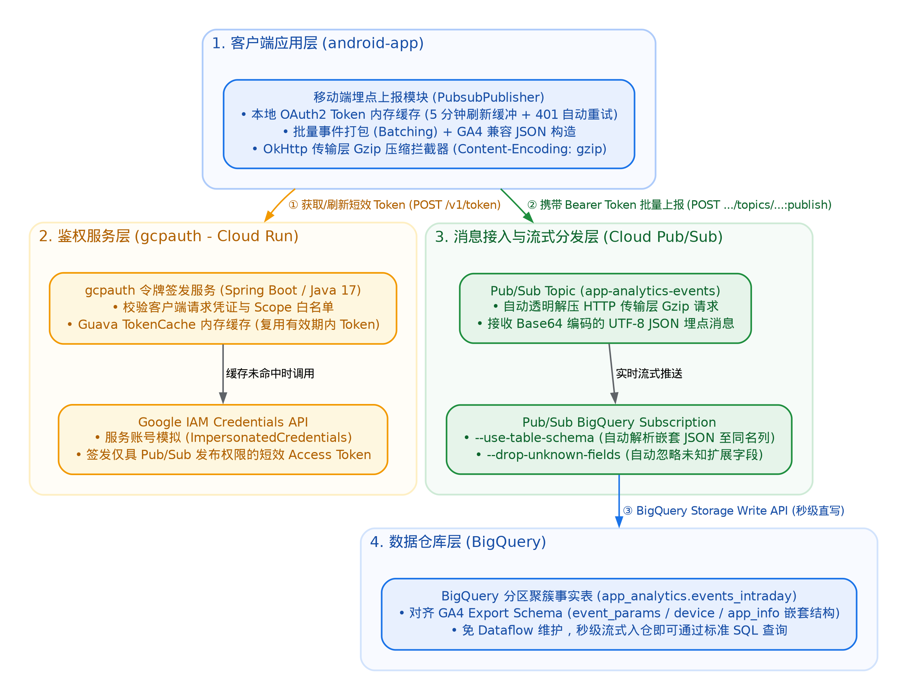
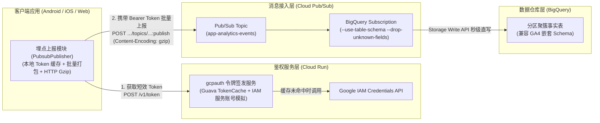

# pubsubauth：移动端埋点直连 Cloud Pub/Sub 与 BigQuery 实时入仓方案

本项目提供了一套完整的参考实现，展示如何在客户端应用中免硬编码密钥获取短效受限 OAuth 2.0 令牌，将对齐 **Google Analytics 4 (GA4) / Firebase BigQuery Export Schema** 的行为埋点事件通过 **Cloud Pub/Sub** 直接流式写入 **BigQuery**，无需部署或维护中间 Dataflow / 消费集群。

## 方案架构图

## 核心方案特性

1. **客户端无密钥安全鉴权 (`gcpauth`)**：
   - 部署于 **Cloud Run**，采用 **双服务账号 + IAM Impersonation（服务账号模拟 `ImpersonatedCredentials`）** 模式。
   - 签发短效（默认 3600 秒）、最小权限（仅限 `https://www.googleapis.com/auth/pubsub` 发布权限）的 OAuth 2.0 Access Token，避免在客户端安装包中内置任何 GCP 服务账号私钥。
   - 内置服务端内存缓存（`TokenCache`，默认 TTL 1800 秒）与剩余有效期校验，单实例每 30 分钟仅需请求一次 Google IAM API，规避 IAM 配额瓶颈并支撑高并发请求。

2. **高效客户端上报 (`android-app`)**：
   - **本地 Token 缓存与自动刷新**：客户端在内存中缓存获取到的 Access Token 及过期时间（设置 5 分钟提前刷新缓冲窗口），并在遇到 HTTP `401 Unauthorized` 时自动清除缓存并重试一次。
   - **网络传输层 Gzip 压缩 (`GzipRequestInterceptor`)**：通过 `OkHttp` 拦截器对 `:publish` 的 HTTP POST 请求体启用 `Content-Encoding: gzip` 流式压缩，同时保持 `PubsubMessage.data` 为未压缩 UTF-8 JSON 的 Base64 编码。Google 前端（GFE）/ Pub/Sub 服务端在接收时自动在传输层透明解压，既节省 70%~85% 客户端上行流量，又允许下游 BigQuery Subscription 直接解析 JSON 字段。
   - **GA4 兼容事件格式**：`AsyncTaskPubsub.buildTestData()` 直接构造包含 `event_date`、`event_timestamp`、`event_name`、`user_pseudo_id`、`event_params`（`ARRAY<STRUCT<key, value>>`）、`device`、`app_info` 的嵌套 JSON。

3. **免 ETL 秒级直写 BigQuery (`BigQuery Subscription`)**：
   - 通过配置启用 `--use-table-schema` 与 `--drop-unknown-fields` 的 **Cloud Pub/Sub BigQuery Subscription**，底层直接调用 BigQuery Storage Write API 将 Topic 中的 JSON 消息拆解写入 BigQuery 分区聚簇表，数秒内即可通过标准 SQL（如 `UNNEST(event_params)`）查询分析。

## 目录结构

- **[`gcpauth`](./gcpauth/README.MD)**：基于 Spring Boot (Java 17) 的短效 OAuth2 Token 签发服务（部署于 Cloud Run）。
- **[`android-app`](./android-app/app/README.MD)**：Android 客户端示例工程（含本地 Token 缓存、HTTP 传输层 Gzip 压缩拦截器与 GA4 埋点事件上报）。

## 快速开始

1. 参考 **[gcpauth 部署指南](./gcpauth/README.MD)** 配置服务账号模拟权限并将鉴权服务部署至 Cloud Run。
2. 在 BigQuery 中创建兼容 GA4 Schema 的目标表，并创建 Pub/Sub Topic 与 BigQuery Subscription（开启 `--use-table-schema` 与 `--drop-unknown-fields`）。
3. 参考 **[Android 客户端指南](./android-app/app/README.MD)** 更新 `ConfigConstant.java` 配置并运行客户端发送埋点事件。
